# Démarrage rapide

**namfoop transforme un PC Linux et une carte son USB en multi-effet de basse pour la scène** :
des amplis et des pédales capturés par réseau de neurones (modèles NAM), des baffles (IR), une
chaîne d'effets que tu bâtis à l'écran, et ta set list au pied — avec une latence de l'ordre de
5 ms. Tout se pilote au clavier, dans un terminal.

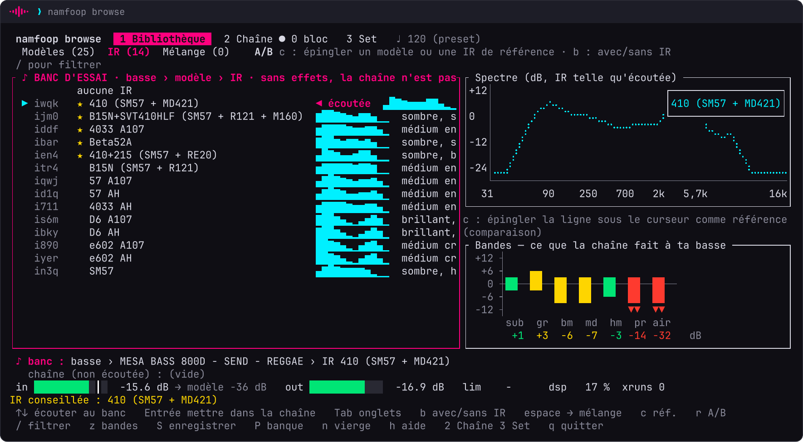

Cette page te mène de l'installation à ton premier concert, en six étapes. Chacune renvoie à la
section du [guide complet](guide.md) qui la détaille.

| | Étape | Commande | Durée |
|---|---|---|---|
| 1 | [Installer](#1-installer) | `cargo build --release` | 5 min |
| 2 | [Configurer la carte son](#2-configurer-la-carte-son) | `namfoop setup` | 2 min, une fois |
| 3 | [Calibrer ta basse](#3-calibrer-ta-basse) | `namfoop calibrate` | 15 s, une fois |
| 4 | [Importer et écouter des modèles NAM et des IR](#4-importer-et-écouter-des-modèles-nam-et-des-ir) | `namfoop import`, `namfoop browse` | |
| 5 | [Bâtir une chaîne d'effets](#5-bâtir-une-chaîne-deffets) | `namfoop browse` | |
| 6 | [Monter une set list et la jouer](#6-monter-une-set-list-et-la-jouer) | `namfoop run --set` | |

## Le son, de ta basse à la sono

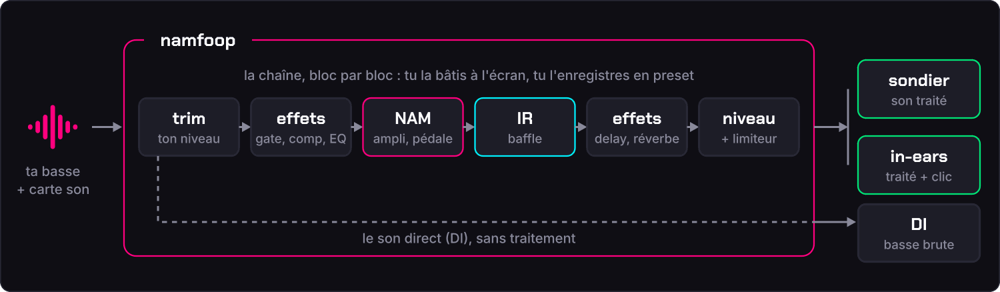

- Un **modèle NAM** (`.nam`) est la capture d'un ampli, d'une pédale ou d'un rig complet : c'est
  lui qui fait le grain.
- Une **IR** (`.wav`) est la réponse d'un baffle et de son micro. Un ampli capturé seul en a
  besoin ; un rig capturé avec son baffle s'en passe — namfoop l'indique pour chaque modèle.
- Les **effets** entourent ces deux blocs : gate, compresseur et EQ avant, chorus, delay et
  réverbe après.
- Chaque **sortie** de la carte a son rôle : le son traité pour le sondier et tes in-ears, la
  basse brute pour un DI.

**Ce qu'il te faut** : un PC sous Linux, une carte son USB, ta basse, et quelques modèles NAM et
IR — [Tone3000](https://www.tone3000.com) en propose des milliers, et les packs du commerce
conviennent aussi. Pas de carte sous la main ? Tout ce qui suit se rejoue sur une **carte
simulée**, où une basse de synthèse joue à ta place : ajoute `--backend sim` après `namfoop`.

---

## 1. Installer

Il faut un compilateur C++, `git`, [rustup](https://rustup.rs) et les fichiers de développement
d'ALSA — une seule commande selon ta distribution, donnée dans le
[README](../README.md#prérequis-de-compilation).

```sh
git clone --recurse-submodules https://github.com/cedricbou/namfoop.git
cd namfoop
cargo build --release
cp target/release/namfoop ~/.local/bin/        # pour taper « namfoop » partout
```

→ En détail : [Installation](guide.md#3-installation), [Réglages du système](guide.md#4-réglages-du-système)
(la priorité temps réel, à régler avant de jouer en public).

## 2. Configurer la carte son

Branche la basse sur une entrée instrument de la carte, puis lance l'assistant :

```sh
namfoop setup
```

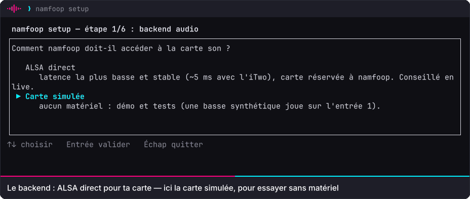

L'assistant se parcourt aux flèches et à `Entrée` :

- **les entrées** — joue une note : le vumètre qui bouge montre où est ta basse ;
- **les sorties** — donne son rôle à chacune (sondier, in-ear, DI) ; `t` y envoie un bip pour la
  repérer. Baisse le volume avant le premier ;
- **le buffer** — chaque taille est essayée cinq secondes, la plus petite qui tient est proposée ;
- **le résumé** — `Entrée` enregistre. Toutes les commandes utilisent ensuite cette carte et ce
  routage, sans aucune option.

→ En détail : [Matériel et câblage](guide.md#2-matériel-et-câblage),
[l'assistant](guide.md#5-configurer-la-carte--lassistant).

## 3. Calibrer ta basse

Un modèle NAM réagit au niveau qu'il reçoit : une basse qui entre trop fort le fait saturer bien
plus que sur les démos. namfoop mesure donc **ton** niveau, une fois.

```sh
namfoop calibrate
```

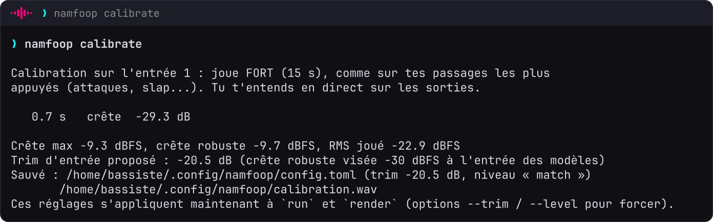

Joue **fort** pendant quinze secondes, comme sur tes passages les plus appuyés. namfoop en déduit
le **trim** d'entrée et aligne le volume de sortie sur celui de ta basse en direct : d'un son à
l'autre, le niveau reste le même et l'oreille juge le timbre. À refaire si tu changes de basse ou
le gain de la carte.

→ En détail : [Calibrer sa basse](guide.md#7-calibrer-sa-basse),
[Lire les vumètres](guide.md#lire-les-vumètres).

## 4. Importer et écouter des modèles NAM et des IR

Donne à `import` tes zips tels que tu les as téléchargés, ou un dossier entier :

```sh
namfoop import ~/Téléchargements/pack.zip
namfoop import nam/                            # chaque zip du dossier devient un pack
```

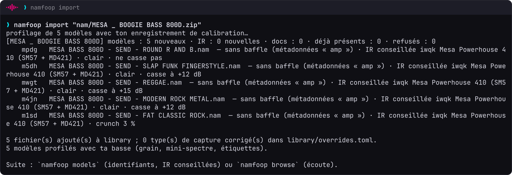

Chaque fichier est rangé, vérifié et analysé avec ta basse : type de capture (avec ou sans
baffle), grain, spectre, et l'**IR conseillée** pour un ampli capturé seul. Puis écoute :

```sh
namfoop browse
```

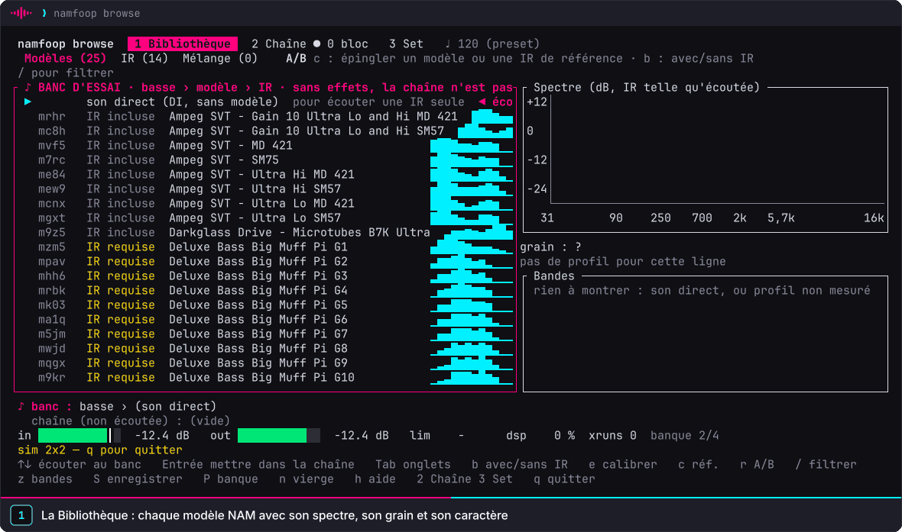

Le navigateur **joue en direct**. Dans la **Bibliothèque** (`1`, en magenta), tu écoutes au banc
d'essai `basse › modèle › IR`, sans aucun effet, et le son change sans coupure ni clic.

| Touche | |
|---|---|
| `↑` `↓` | écouter le modèle ou l'IR sous le curseur |
| `/` | filtrer la liste |
| `Tab` | passer d'un onglet à l'autre : Modèles, IR, Mélange |
| `b` | avec ou sans l'IR · `c` puis `r` : comparer deux sons en A/B, à volume égal |
| `Entrée` | **mettre ce que tu entends dans la chaîne** |
| `h` | l'aide de l'écran où tu es — elle existe partout |

→ En détail : [La bibliothèque de sons](guide.md#6-la-bibliothèque-de-sons),
[Choisir son son en jouant](guide.md#choisir-son-son-en-jouant--namfoop-browse),
[Mélanger plusieurs IR](guide.md#mélanger-plusieurs-ir).

## 5. Bâtir une chaîne d'effets

Toujours dans `browse`, `2` ouvre l'espace **Chaîne** (en cyan) : ton son de l'entrée à la
sortie, bloc par bloc, avec un vumètre au-dessus de chacun.

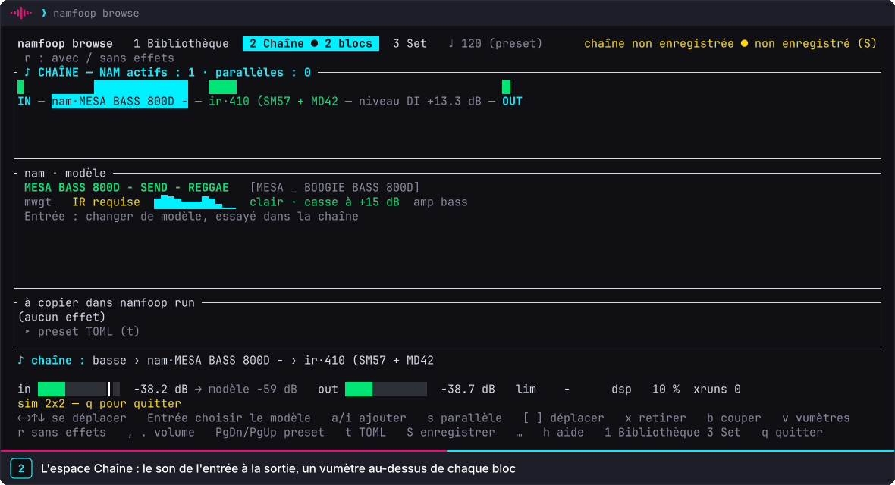

| Touche | |
|---|---|
| `←` `→` | aller de bloc en bloc |
| `a` / `i` | ouvrir le catalogue et ajouter **après** / **avant** le curseur |
| `Entrée` | régler le bloc : `↑` `↓` choisit le réglage, `←` `→` change la valeur |
| `[` `]` | déplacer le bloc · `x` le retirer · `b` le couper sans le retirer |
| `r` | écouter avec et sans les effets |
| `S` | **enregistrer la chaîne en preset** · `P` : la banque de tes presets |

L'ordre qui marche presque toujours : gate puis compresseur **avant** l'ampli, EQ, chorus, delay
puis réverbe **après** le baffle.

Une touche de plus, `s`, met l'ampli **en parallèle** du son direct : sous 150 Hz le grave reste
clair, au-dessus il passe dans l'ampli. C'est ce qui garde de l'assise sous une fuzz.

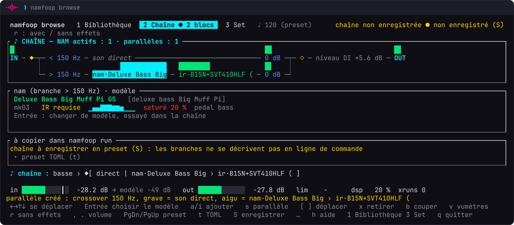

Un preset se rejoue ensuite sans écran :

```sh
namfoop presets                        # la banque et ses identifiants
namfoop run --preset "reggae rond"     # par nom, mots-clés ou identifiant
```

→ En détail : [Effets](guide.md#10-effets) (chaque effet et ses réglages),
[Rejouer un preset](guide.md#rejouer-un-preset--namfoop-presets-run---preset),
[Régler le son et le volume](guide.md#9-régler-le-son-et-le-volume).

## 6. Monter une set list et la jouer

Un **set** est la liste des morceaux d'un concert, chacun avec ses sons : des presets de ta
bibliothèque. Dans `browse`, `3` ouvre l'espace **Set** (en vert) ; `L` crée un set, `e` l'édite.

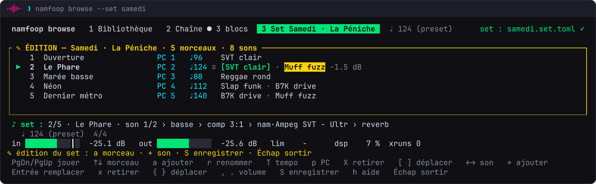

| Touche, en édition | |
|---|---|
| `a` | ajouter un morceau · `r` le renommer · `T` son tempo · `p` son Program Change |
| `+` | ajouter un son au morceau : la liste des presets s'ouvre, `↑` `↓` les font entendre |
| `,` `.` | le volume du son dans ce morceau |
| `S` | enregistrer le set |

Chaque morceau peut porter son **prompteur** — accords, paroles et repères, dans un fichier
ChordPro que `t` ouvre dans ton éditeur. Avant de partir, vérifie que rien ne manque :

```sh
namfoop sets
```

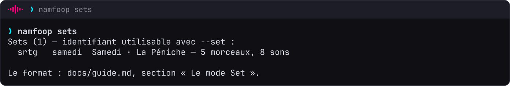

Sur scène, joue le set avec l'écran **verrouillé** : seuls les gestes de concert répondent, rien
ne s'édite par accident.

```sh
namfoop run --set samedi
```

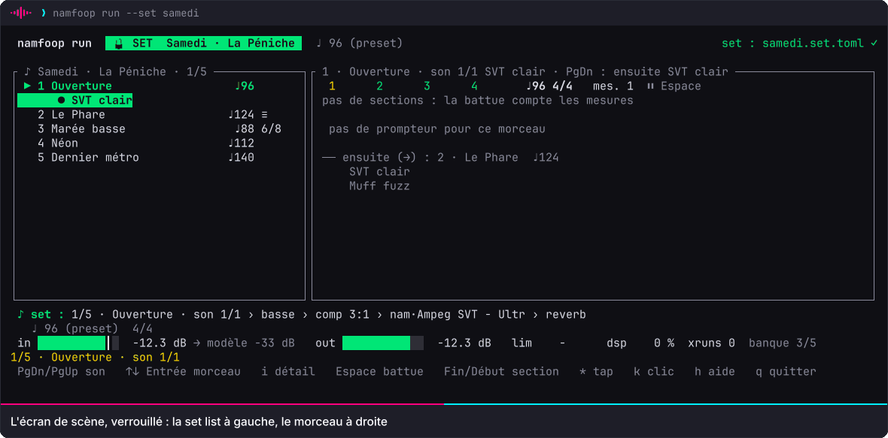

| Touche | |
|---|---|
| `↑` `↓` puis `Entrée` | viser un morceau, puis le jouer |
| `PgDn` / `PgUp` | son suivant / précédent — le geste du pédalier |
| `Espace` | lancer la battue : l'appui est le 1 de la mesure |
| `*` | tap tempo · `k` : le clic, dans les in-ears seulement |
| `q` puis `Q` | quitter la scène |

Le son suivant est déjà chargé : la bascule prend 20 ms, et la réverbe du son quitté finit de
sonner. Quand la section suivante du prompteur change de son, un décompte te prévient.

→ En détail : [Le mode Set](guide.md#11-le-mode-set--la-set-list-de-concert),
[le prompteur](guide.md#le-prompteur--accords-paroles-et-cues-chordpro),
[la battue](guide.md#la-battue-et-la-mesure--espace).

---

## Et après

| Pour… | Voir |
|---|---|
| changer de son au pied, suivre l'horloge d'Ableton | [Piloter namfoop au pied : le MIDI](guide.md#12-piloter-namfoop-au-pied--le-midi) |
| caler un delay sur le tempo, avoir un clic | [Tempo et divisions rythmiques](guide.md#tempo-et-divisions-rythmiques----tempo-division) |
| mesurer ta latence réelle | [Mesurer la latence](guide.md#15-mesurer-la-latence) |
| traiter un fichier, comparer deux réglages hors ligne | [Travailler sans jouer](guide.md#14-travailler-sans-jouer--rendu-bench-inventaire) |
| un craquement, une carte muette | [Dépannage](guide.md#17-dépannage) |
| toutes les commandes et leurs options | [Référence des commandes](cli.md) |

Les images de cette page sont de vraies captures, refaites par `scripts/gen-demarrage.py` sur la
carte simulée. Les marques citées appartiennent à leurs propriétaires ; les modèles et les IR ne
sont pas distribués avec namfoop.
