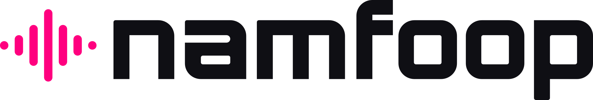
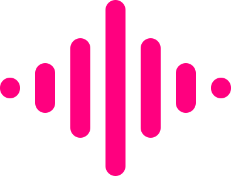
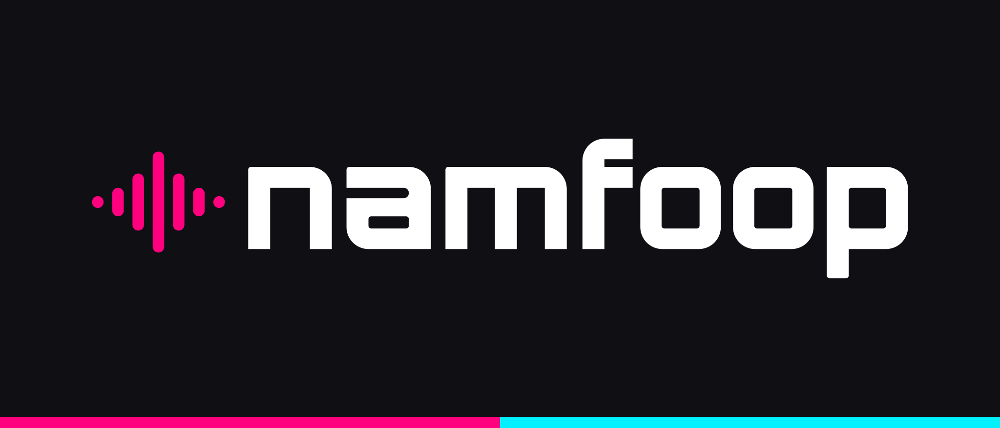

# Charte graphique de namfoop

Les principes, les couleurs, les polices et les images de **namfoop** : de quoi garder une seule
identité d'un écran de terminal à la page du dépôt, d'une maquette à un boîtier. Les images vivent
dans ce dossier, `docs/identite/`, et nulle part ailleurs : aucun lien vers un hébergeur extérieur,
qui finirait par casser.

<picture>
  <source media="(prefers-color-scheme: dark)" srcset="logo-sombre.svg">
  
</picture>

## L'ADN de la marque

**namfoop** est un multi-effet basse temps réel en ligne de commande pour Linux, motorisé par des
modèles neuronaux NAM (*Neural Amp Model*) et des réponses impulsionnelles (IR) de baffles.

**La promesse** : transformer une machine Linux et une carte son USB en un pédalier de scène sans
compromis — quelques millisecondes de latence aller-retour, changement de preset sans coupure,
contrôle total au clavier comme au pied via MIDI.

Quatre piliers portent tout ce qu'on dessine :

- **Précision temps réel** : accès ALSA direct, priorité temps réel, alignement de niveau mesuré,
  zéro fioriture.
- **Fiabilité de scène** : écran de concert verrouillé, chaînes préchargées en mémoire, queues de
  réverbe et de delay qui finissent de sonner.
- **Culture libre et ligne de commande** : fichiers TOML lisibles, code Rust, licence GPL-3.0.
- **Énergie instrumentale** : une esthétique nocturne, électrique et directe, tirée des racks de
  studio, des pédaliers modernes et des terminaux Linux.

## Palette

| Couleur | HEX | RVB | Terminal | Usage |
| :--- | :--- | :--- | :--- | :--- |
| **Noir d'encre** | `#0F0F14` | 15, 15, 20 | — | Fond des visuels, texte sur fond clair |
| **Gris Graphite** | `#1E1E28` | 30, 30, 40 | — | Fonds secondaires : cartes, blocs de code, panneaux |
| **Gris Acier** | `#8A8A9C` | 138, 138, 156 | `DarkGray` | Texte secondaire, éléments inactifs |
| **Blanc Pur** | `#FFFFFF` | 255, 255, 255 | `White` | Logo sur fond sombre, titres, texte courant |
| **Magenta Électrique** | `#FF007F` | 255, 0, 127 | `Magenta` | Signature : l'onde ; dans l'app, l'espace **Bibliothèque** |
| **Cyan Néon** | `#00F0FF` | 0, 240, 255 | `Cyan` | Accent : les chevrons ; dans l'app, l'espace **Chaîne** et l'écoute A |
| **Vert Signal** | `#00E676` | 0, 230, 118 | `Green` | Espace **Set** (vue scène), vumètres sains |
| **Jaune Ambre** | `#FFD600` | 255, 214, 0 | `Yellow` | Mode **Édition**, référence B, cues du prompteur |
| **Rouge Clip** | `#FF3B30` | 255, 59, 48 | `Red` | Saturation (`[CLIP]`), limiteur actif, IR coupée, erreurs |

La colonne **Terminal** donne la couleur de base à employer quand le terminal ne sait pas afficher
les teintes exactes. Les deux gris de fond n'en ont pas : dans le terminal, le fond n'appartient pas
à la charte (voir plus bas).

Le **Gris Acier** est choisi pour rester lisible sur le noir d'encre : son contraste y est de 5,6
pour 1, au-dessus du seuil AA des recommandations d'accessibilité — la marge sert à le lire de
loin, sur scène.

**L'équilibre 80 / 15 / 5** vaut pour les visuels — page du dépôt, bannière, maquette, imprimé :
80 % de la surface reste neutre (noir d'encre, gris, blanc), 15 % porte le duo signature magenta +
cyan, 5 % au plus revient aux couleurs fonctionnelles. Dans le terminal, c'est une autre règle.

## Dans le terminal

Sur un écran de namfoop, la charte donne **les couleurs d'accent, pas le fond** : le fond reste
celui du terminal de l'utilisateur. C'est le choix sûr sur scène comme sur la console du Pi, où
personne ne sait d'avance sur quel thème l'écran va s'ouvrir.

Les couleurs n'y décorent pas, elles portent l'information : chaque espace a la sienne —
Bibliothèque magenta, Chaîne cyan, Set vert —, l'édition est jaune, la saturation rouge, le texte
secondaire gris. La proportion 80 / 15 / 5 ne s'y applique donc pas.

Un terminal qui annonce savoir afficher les couleurs exactes reçoit les codes de la palette. Les
autres reçoivent les couleurs de base de la colonne **Terminal** : l'écran garde sa lecture, dans
les teintes du thème de l'utilisateur.

## Typographies

Trois polices libres (Google Fonts, licence SIL OFL), pour ne dépendre d'aucun dessin sur mesure :

| Rôle | Police | Graisses |
| :--- | :--- | :--- |
| Titres, slogans, marquage d'un boîtier | **Chakra Petch** | Bold 700 pour les titres, SemiBold 600 pour les sous-titres et les étiquettes de façade |
| Texte courant et documentation | **Inter** | Regular 400 pour les paragraphes, Medium 500 pour les légendes et les tableaux, Bold 700 pour les mises en valeur |
| Commandes, schémas de signal, valeurs | **JetBrains Mono** | Regular 400 et Medium 500 |

Les angles biseautés de Chakra Petch s'accordent à l'univers de namfoop ; Inter est dessinée pour la
lisibilité à l'écran comme sur papier ; la chasse fixe de JetBrains Mono rend nets les lignes de
commande, les fichiers `.toml` et les blocs Unicode.

**Le logo ne se retape jamais dans une police**, Chakra Petch comprise. Ses lettres sont un dessin :
on utilise toujours l'image.

## Les images

| Fichier | Quoi | Où s'en servir |
| :--- | :--- | :--- |
| `logo-sombre.svg` | Logo, lettres blanches, fond transparent | Fond sombre : terminal, interfaces et pages sombres |
| `logo-clair.svg` | Logo, lettres noir d'encre, fond transparent | Fond clair : fiches imprimées, stickers, supports physiques |
| `onde.svg` | L'onde seule | Là où le mot ne tient pas |
| `icone.svg` | Icône carrée, tuile noir d'encre | Avatar, lanceur, profil |
| `icone-512.png`, `icone-256.png`, `icone-128.png`, `icone-64.png`, `icone-32.png` | Exports carrés de l'icône | Lanceur, profil, documentation |
| `favicon.ico` | Icône 16, 32 et 48 pixels | Favicon d'un site |
| `banniere.svg` | Bannière 21:9, fond plein | Haut de la page du dépôt |

  
  

Tout est vectoriel : les logos, l'onde, l'icône et la bannière restent nets à toutes les tailles, et
chaque fichier pèse quelques kilo-octets. Les exports carrés et le favicon sont là pour les endroits
qui réclament une image matricielle.

## Règles d'usage

- **Zone de protection** : autour du logo, laisser un vide au moins égal à la hauteur de la lettre
  `n` — soit, à peu près, la largeur de l'onde.
- **Taille minimale** : 90 pixels de large pour le logo complet. En dessous, employer l'icône
  carrée, lisible jusqu'à 32 pixels.
- **Jamais** : étirer ou écraser le logo, écrire NAMFOOP en majuscules, lui ajouter une ombre ou un
  contour, poser le logo à lettres blanches sur un fond clair.

## Licence des images

Le logo, l'icône, l'onde et la bannière de ce dossier sont **tous droits réservés**. On peut s'en
servir pour parler de namfoop ou y renvoyer ; pas pour un autre projet, pas pour un produit dérivé.
Le code de namfoop, lui, est sous licence GPL-3.0-or-later.
